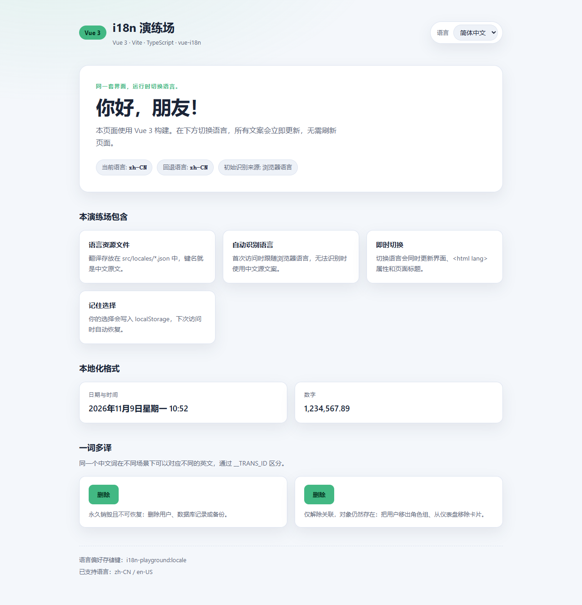
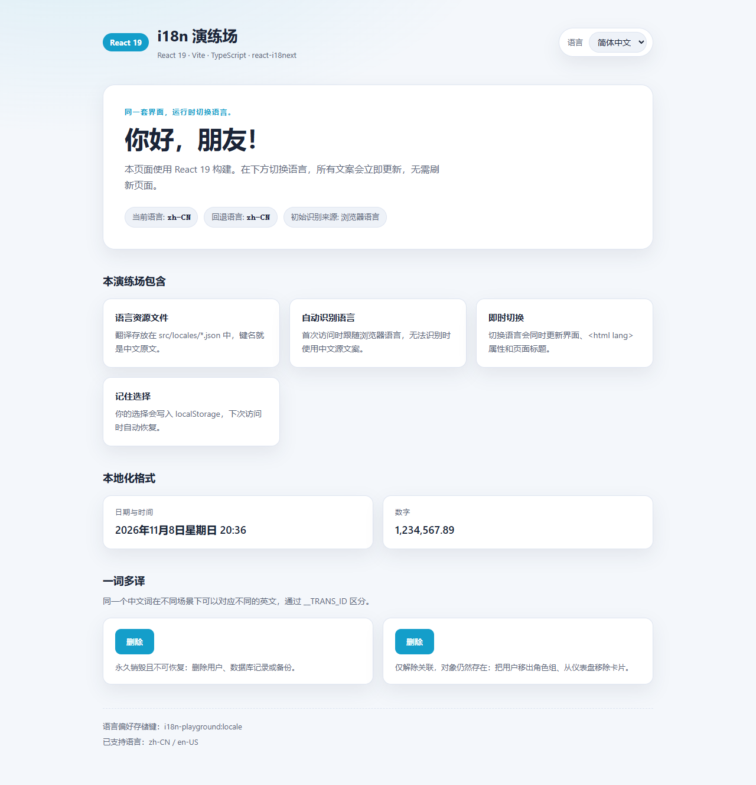

# i18n-llm-trans

一个**与运行时解耦**的 i18n 工作流 CLI：扫描代码里的 `t()` 调用，维护语言 JSON，并在需要时调用
LLM 生成译文；不提供 React/Vue 运行时包，`t()` 由应用按 [契约](docs/i18n-contract.md) 自行实现。

- **`i18n:check`**：Babel 静态扫描 `t()`，对比源语言 / 目标语言 JSON，报告缺失、未使用、多余；
- **`i18n:fix`**：补源语言 key、给目标语言写 `⟦TODO⟧` 占位、删除未使用 / 多余项；
- **`i18n:trans`**：通过 OpenAI-compatible LLM 翻译未翻译 key，写出 `⟦REVIEW⟧` 待复核译文；
- **运行时无关**：Vite / webpack / SSR / 微前端 / React / Vue 都可以，只要满足数据格式与 `t()` 契约。

## 为什么没有 runtime 包

运行时环境差异太大（构建工具、SSR、多实例、i18next 版本、微前端…），封装一个通用包很难覆盖所有场景；
而 CLI 真正依赖的只是「JSON 键格式 + `t()` 调用形态」。所以本仓库只维护 CLI，把运行时留给应用：

- 契约与类型模板：[docs/i18n-contract.md](docs/i18n-contract.md)、[docs/templates/translator.ts](docs/templates/translator.ts)
- 完整参考实现：[playground/react/src/i18n/index.ts](playground/react/src/i18n/index.ts)
- 对比示例：Vue playground 使用 vue-i18n 的语义化 key

## 目录结构

```
i18n-llm-trans/
├─ package.json
├─ pnpm-workspace.yaml
├─ packages/
│  └─ i18n-llm-trans-cli/        # @10coding/i18n-llm-trans-cli
│     ├─ src/                    # scan / check / fix / trans / LLM client
│     ├─ test/                   # vitest
│     └─ dist/                   # 构建产物
├─ playground/
│  ├─ react/                     # React + i18next，按契约实现的参考演示
│  │  ├─ src/i18n/index.ts       # 本地 t() 参考实现（非发布包）
│  │  ├─ src/locales/            # zh-CN / en-US / ja-JP
│  │  └─ i18n.config.json
│  └─ vue/                       # Vue + vue-i18n（语义化 key，作对比）
├─ docs/
│  ├─ i18n-contract.md           # 数据格式 + t() 行为契约
│  ├─ templates/translator.ts    # 可复制的 t() 核心实现
│  └─ *.png                      # 预览截图
└─ README.md
```

## 快速开始

环境要求：Node.js `>= 20.19`、pnpm。

```bash
pnpm install

# 检查语言文件（源语言 + 目标语言）
pnpm i18n:check

# 补 key / 占位
pnpm i18n:fix

# 用 LLM 翻译（先在 playground/react/.env 配置模型）
pnpm i18n:trans

pnpm dev:react    # http://localhost:5174
pnpm dev:vue      # http://localhost:5173
```

## 预览

| Vue 3（语义化 key）                                                                             | React 19（原文即 key + 标记复核）                                                                    |
| ---------------------------------------------------------------------------------------------- | --------------------------------------------------------------------------------------------------- |
|  |  |

## 常用脚本

| 命令 | 说明 |
| --- | --- |
| `pnpm dev:vue` | 启动 Vue playground（5173） |
| `pnpm dev:react` | 启动 React playground（5174） |
| `pnpm build` | 递归构建 CLI + 两个 playground |
| `pnpm build:cli` | 仅构建 CLI 包 |
| `pnpm build:vue` / `pnpm build:react` | 仅构建对应应用 |
| `pnpm typecheck` | 递归类型检查 |
| `pnpm test` | 运行 CLI 单元测试（vitest） |
| `pnpm i18n:check` | 检查源语言 + 目标语言（缺 key 时退出码 1） |
| `pnpm i18n:check:source` | 只检查源语言 |
| `pnpm i18n:check:target` | 只检查目标语言 |
| `pnpm i18n:fix` | 补源语言 key、补 `⟦TODO⟧` 占位、删未使用 / 多余项 |
| `pnpm i18n:trans` | 用 OpenAI-compatible LLM 翻译（需 `.env`） |
| `pnpm preview:vue` / `pnpm preview:react` | 预览生产构建 |

## CLI

`packages/i18n-llm-trans-cli` 用 Babel 静态扫描 `t()` 调用，与语言 JSON 对比；扫描逻辑与框架无关。
完整参数与配置见 [CLI README](packages/i18n-llm-trans-cli/README.md)。

```bash
pnpm i18n:check          # 源语言 + 目标语言
pnpm i18n:check:source   # 只检查源语言
pnpm i18n:check:target   # 只检查目标语言

pnpm i18n:fix            # check --add --add-target --remove
pnpm i18n:trans          # 翻译未翻译 / 占位 key（需要 .env）
```

### 翻译环境（.env）

`trans` 从 `playground/react/.env` 读取 OpenAI-compatible 配置（已 gitignore，模板见
[.env.example](playground/react/.env.example)）：

```bash
I18N_LLM_BASE_URL=https://api.deepseek.com/v1
I18N_LLM_API_KEY=sk-...
I18N_LLM_MODEL=deepseek-chat
```

### 标记约定

| 标记 | 写入者 | 含义 |
| --- | --- | --- |
| `⟦TODO⟧ 原文` | `i18n:fix --add-target` | key 存在，还没有译文 |
| `⟦REVIEW⟧ 译文` | `i18n:trans` | AI 已翻译，等待人工复核 |
| 无标记 | 人工 / `trans --ignore` | 已确认译文 |

复核方式：编辑器全局搜索 `⟦REVIEW⟧` 删除标记；搜索 `⟦TODO⟧` 可确认是否还有缺翻译。
`trans` 不会重复翻译 `⟦REVIEW⟧` 值，也不会覆盖已有译文。

## t() 契约

应用可自行实现 `t()`，必须满足：

```ts
type Translate = (
  source: SourceKey,
  options?: { __TRANS_ID?: string | number; [param: string]: unknown } | string | number,
) => string
```

- `t('删除', 'remove')` 等价于 `t('删除', { __TRANS_ID: 'remove' })`；
- 查找顺序：目标语言 `删除__TRANS_ID_remove` → 目标语言 `删除` → 源语言 `删除` → 原文；
- 源语言直接返回原文；插值支持 `{name}`（vue-i18n）与 `{{name}}`（i18next），译文需保留相同写法；
  JSON 扁平、关闭 keySeparator；
- 完整说明与类型模板：[docs/i18n-contract.md](docs/i18n-contract.md)，
  可直接复制 [docs/templates/translator.ts](docs/templates/translator.ts)。

## playground/react 参考实现

[playground/react/src/i18n/index.ts](playground/react/src/i18n/index.ts) 用 i18next 实现了上述契约
（检测、持久化、`<html lang>` / `document.title` 同步都在应用侧），只作示例、不作为 npm 包发布。

它包含三种语言：`zh-CN`（源语言）、`en-US`、`ja-JP`，并演示：

- `t('删除', 'delete')` / `t('删除', { __TRANS_ID: 'remove' })` 一词多译；
- `i18n:fix` 的 `⟦TODO⟧` 占位与 `i18n:trans` 的 `⟦REVIEW⟧` 译文标记；
- 语言切换、localStorage 持久化、浏览器语言检测。

## playground/vue

Vue 应用使用 vue-i18n 的语义化 key（`features.localeFiles.title`），与 React 的「原文即 key」形成对比；
CLI 目前只面向原文即 key 的模型，Vue 示例保留作对照。

## 新增语言 / 翻译流程

1. 新建 `src/locales/ja-JP.json`（空对象即可）；
2. 加入 `i18n.config.json` 的 `targetLocales`，以及应用自己的语言列表；
3. `pnpm i18n:check:target` 查看缺失；
4. `pnpm i18n:fix` 写 `⟦TODO⟧ 原文` 占位；
5. `pnpm i18n:trans` 生成 `⟦REVIEW⟧ 译文`；
6. 编辑器搜索 `⟦REVIEW⟧` 人工复核；
7. `pnpm i18n:check` 应通过。
