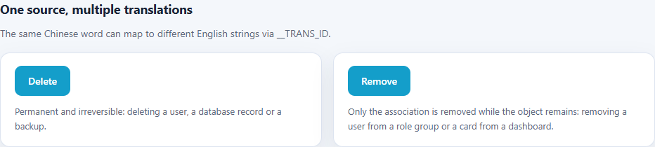

# i18n-llm-trans

基于 **pnpm workspace + Vite + TypeScript** 的前端多语言仓库：

- `packages/i18n-llm-trans-react`：可发布的 React i18n 运行时
  （[`@10coding/i18n-llm-trans-react`](packages/i18n-llm-trans-react/README.md)），
  实现**源语言原文即 key**（示例为中文键）与 `__TRANS_ID` 一词多译；
- ` playground/` 下 **Vue** 与 **React** 两个演练应用：Vue 使用语义化 key（vue-i18n），
  React 使用上述包（本仓库以中文为源语言），便于对比两种维护方式，也便于后续接入 LLM
  批量翻译语言包。

## 目录结构

```
i18n-llm-trans/
├─ package.json                  # workspace 根：统一脚本入口
├─ pnpm-workspace.yaml           # workspace 声明：playground/*、packages/*
├─ packages/
│  ├─ i18n-llm-trans-react/      # @10coding/i18n-llm-trans-react
│  │  ├─ src/core/               # 检测、中文键解析、__TRANS_ID、回退（无框架依赖）
│  │  ├─ src/react/              # useI18n Hook
│  │  ├─ src/createI18nRuntime.ts
│  │  ├─ test/                   # vitest 单元测试
│  │  └─ dist/                   # ESM + CJS + d.ts（构建产物）
│  └─ i18n-llm-trans-cli/        # @10coding/i18n-llm-trans-cli
│     ├─ src/scan.ts             # Babel 扫描 t() 调用
│     ├─ src/check.ts            # 语言 JSON 对比 / 增删
│     ├─ test/                   # vitest 测试
│     └─ dist/                   # CLI 构建产物
├─ playground/
│  ├─ vue/                       # Vue 3 + Vite + TS + vue-i18n
│  │  ├─ src/locales/            # en-US.json / zh-CN.json（语义化 key）
│  │  ├─ src/i18n/               # i18n 实例、语言检测、语言切换
│  │  └─ src/components/LanguageSwitcher.vue
│  └─ react/                     # React 19 + Vite + TS + 上面的包
│     ├─ src/locales/            # en-US.json / zh-CN.json（中文键 / 中文值）
│     ├─ src/i18n/               # 薄适配层：注入资源、标题模板、存储 key
│     ├─ src/app-config.ts       # 各语言一致的静态标识
│     ├─ i18n.config.json        # i18n:check 配置
│     └─ src/components/LanguageSwitcher.tsx
├─ docs/                         # 界面截图
└─ README.md
```

## 快速开始

环境要求：Node.js `>= 20.19`、pnpm。

```bash
pnpm install

# React 应用依赖本地包，dev 脚本会先构建包
pnpm dev:react    # http://localhost:5174
pnpm dev:vue      # http://localhost:5173

pnpm build        # 递归构建：包 → 两个应用

pnpm i18n:check   # 静态扫描 t()，检查语言 JSON（源语言 + 目标语言）
pnpm i18n:trans   # 用 LLM 翻译未翻译 / 占位 key（先配置 playground/react/.env）
```

## 预览

下图是浏览器语言为中文时的默认渲染（React 页面底部带「一词多译」演示）：

| Vue 3                                                                                          | React 19                                                                                            |
| ---------------------------------------------------------------------------------------------- | --------------------------------------------------------------------------------------------------- |
|  |  |

## 常用脚本

| 命令                  | 说明                                                |
| --------------------- | --------------------------------------------------- |
| `pnpm dev:vue`        | 启动 Vue playground 开发服务器（5173）              |
| `pnpm dev:react`      | 先构建 i18n 包，再启动 React playground（5174）     |
| `pnpm build`          | 递归构建全部项目（包 → Vue → React）                |
| `pnpm build:package`  | 仅构建 `@10coding/i18n-llm-trans-react`             |
| `pnpm build:cli`      | 仅构建 `@10coding/i18n-llm-trans-cli`               |
| `pnpm build:vue`      | 仅构建 Vue 应用                                     |
| `pnpm build:react`    | 构建 i18n 包后再构建 React 应用                     |
| `pnpm i18n:check`     | 检查源语言 + 目标语言（缺 key 时退出码 1）          |
| `pnpm i18n:check:source` | 只检查源语言                                    |
| `pnpm i18n:check:target` | 只检查目标语言                                  |
| `pnpm i18n:fix`       | 补源语言 key、补目标语言占位 key、删除未使用 / 多余 key |
| `pnpm i18n:trans`     | 用 OpenAI-compatible LLM 翻译未翻译 / 占位 key      |
| `pnpm test`           | 运行包与 CLI 的单元测试（vitest）                   |
| `pnpm typecheck`      | 先构建包，再递归执行类型检查                        |
| `pnpm preview:vue`    | 预览 Vue 应用的生产构建                             |
| `pnpm preview:react`  | 预览 React 应用的生产构建                           |

> React 应用通过 `workspace:*` 引用本地包，`pnpm dev:react` / `pnpm build:react` /
> `pnpm typecheck` 都会先构建包产出 `dist`（类型声明与 ESM/CJS 产物）。
> `i18n:check*` 与 `i18n:trans` 脚本会先构建 CLI 包；`trans` 需要在
> `playground/react/.env` 配置模型（参考 [.env.example](playground/react/.env.example)）。

## 可复用包：`@10coding/i18n-llm-trans-react`

包只提供通用运行时，语言资源、标题、存储 key 与 UI 均留在应用：

```ts
// playground/react/src/i18n/index.ts（节选）
import { createI18nRuntime } from '@10coding/i18n-llm-trans-react'
import zhCN from '../locales/zh-CN.json'
import enUS from '../locales/en-US.json'

export const runtime = createI18nRuntime({
  messages: { 'zh-CN': zhCN, 'en-US': enUS },
  sourceLocale: 'zh-CN',
  detection: { storageKey: 'i18n-playground:locale' },
  document: { title: (t) => `${t('i18n 演练场')} · React 19` },
})

export const { i18nReady, useI18n, translate, setLocale, applyDocumentMetadata } = runtime
```

能力与约束：

- 源语言原文即 key（`sourceLocale` 可设为任意语言）、`__TRANS_ID` 一词多译、
  简写 `t('删除', 'delete')`；
- 语言检测（storage → browser → default）、持久化、`<html lang>` 与 `document.title` 同步；
- `transId`、`detection`、`document`、插值语法均可配置；
- 类型从 `zh-CN.json` 推导，`t()` 的 key 有编译期约束；
- 单实例约定（一个应用只调用一次 `createI18nRuntime`），不使用 React Context；
- `react` / `i18next` / `react-i18next` 为 peerDependencies；
- 同时产出 ESM 与 CJS，可直接发布 npm。

完整 API、配置项与回退规则见 [包 README](packages/i18n-llm-trans-react/README.md)。

## CLI：`i18n:check` / `i18n:trans`

`packages/i18n-llm-trans-cli` 用 Babel 静态扫描 `t()` 调用，与语言 JSON 对比；`trans` 再通过
OpenAI-compatible LLM 补齐译文。扫描逻辑与框架无关（React 先行，换 `callers` 即可适配其他写法）：

```bash
pnpm i18n:check          # 源语言 + 目标语言
pnpm i18n:check:source   # 只检查源语言
pnpm i18n:check:target   # 只检查目标语言

pnpm i18n:fix            # 等价于 check --add --add-target --remove
pnpm i18n:trans          # 翻译未翻译 / 占位 key（需要 .env）
```

规则：

- **源语言 missing**：代码里静态 `t('...')` 用到、但 JSON 没有 → `--add` 以 `"key": "key"` 追加；
- **源语言 unused**：JSON 有、但代码里既没有静态 `t()` 调用、也没有以字符串字面量出现 →
  只警告，`--remove` 才删除（字面量出现视为间接使用，避免误删动态 key）；
- **目标语言 missing**：期望 key（源语言全部 key + 代码中的 `__TRANS_ID` 变体）缺少译文 →
  默认只报告；`--add-target` 写 marker 占位（`⟦TODO⟧ 原文`），由 `i18n:trans` 翻译；
- **目标语言 extra**：不属于期望集合的 key → 警告，`--remove` 删除；
- 动态调用（`t(variable)`、`` t(`x.${id}`) ``）只报告，不参与增删判断；
- 全程无交互：CI 里缺 key 时退出码为 1。

### 翻译环境（.env）

`trans` 从 `playground/react/.env` 读取 OpenAI-compatible 配置（已 gitignore，模板见
[.env.example](playground/react/.env.example)）：

```bash
I18N_LLM_BASE_URL=https://api.openai.com/v1
I18N_LLM_API_KEY=sk-...
I18N_LLM_MODEL=gpt-4o-mini
```

- 未翻译判定 = 目标缺 key，或值为 marker 占位；兼容「值等于源语言原文」的旧占位；
- 自动带入 `t()` 调用处的代码片段作为上下文，`translation.hints` 可手工覆盖；
- 一次请求批量发送 `unit[] → result[]`，串行不并发；校验 key / 占位符，失败重试；
- 只补未翻译内容，不覆盖已有译文；结束后自动跑一次 `i18n-llm-trans check`；
- 缺少环境变量时直接报错，不发起网络请求。

配置见 [playground/react/i18n.config.json](playground/react/i18n.config.json)，完整说明见
[CLI README](packages/i18n-llm-trans-cli/README.md)。

## 多语言能力

两个 playground 共同具备的行为：

1. **语言资源文件**：`src/locales/en-US.json`、`src/locales/zh-CN.json`，由 Vite 直接打包。
2. **自动检测**：首次访问依次尝试 `localStorage` 偏好 → 浏览器语言 → 默认语言。
   - Vue：`zh-*` 命中中文，其余浏览器默认 `en-US`。
   - React：`zh-*` / `en-*` / `ja-*` 分别命中中文 / 英文 / 日文，其余浏览器语言使用中文源语言。
3. **手动切换**：页面右上角的语言下拉框，切换后所有文案即时更新，不会刷新页面。
4. **偏好持久化**：选择结果写入 `localStorage`（键：`i18n-playground:locale`），下次访问自动恢复。
5. **文档元信息同步**：切换语言时同步更新 `<html lang>` 与 `document.title`。
6. **本地化格式**：演示用 `Intl.DateTimeFormat` / `Intl.NumberFormat` 按当前语言格式化日期与数字。
7. **占位符**：两端统一使用单花括号 `{name}`。

对应实现：

- Vue：`createI18n({ legacy: false })` + `useI18n()`。
- React：`@10coding/i18n-llm-trans-react` 的 `createI18nRuntime()` + `useI18n()`。

### React：中文键 / 中文值 + `__TRANS_ID`（本仓库示例）

> 包本身与语言无关：把 `sourceLocale` 设为其他语言，就可以用英文等原文作为 key，
> 详见[包 README](packages/i18n-llm-trans-react/README.md)。

- `zh-CN.json`：键 = 中文原文，值 = 中文原文，同时作为待翻译文案清单。
- `en-US.json`：键与 `zh-CN.json` 相同，值为对应译文。

```jsonc
// playground/react/src/locales/zh-CN.json
{ "你好": "你好" }

// playground/react/src/locales/en-US.json
{ "你好": "hello" }
```

同一个中文原文在不同场景需要不同译文时，调用时传入 `__TRANS_ID`。例如中文都叫「删除」，
英文却必须区分永久销毁的 delete 与仅解除关联的 remove——后台按钮混用会直接误导用户：

```ts
const { t } = useI18n()

t('删除', { __TRANS_ID: 'delete' }) // → en-US.json: { "删除__TRANS_ID_delete": "Delete" }
t('删除', 'remove') // 简写，等价于 { __TRANS_ID: 'remove' } → "Remove"
```

规则与约束：

- 实际查找的键是 `<中文原文>__TRANS_ID_<id>`，`id` 可以是字符串或数字。
- 第二个参数支持简写：`t('删除', 'remove')` 等价于 `t('删除', { __TRANS_ID: 'remove' })`，
  且不依赖标记名配置（改成 `__XXX_ID` 后依然可用）。
- 目标语言缺少该变体时，回退到基础文案的译文；再缺失则回退到中文源文案。
- `zh-CN` 是源语言，始终直接展示中文原文，不会查找带 `__TRANS_ID` 的键。
- `t()` 的入参在编译期被约束为 `zh-CN.json` 中存在的键；`en-US.json` 中若出现不属于
  中文键、也不符合 `<中文键>__TRANS_ID_<id>` 格式的键，同样会直接类型报错。
- React 页面底部的「一词多译」区块就是 `__TRANS_ID` 的实时演示：
  中文下两个按钮都显示「删除」，英文下分别显示 `Delete` / `Remove`，并各自附上语义说明。

英文界面中同一区块的渲染效果：



#### 自定义标记名

标记名与资源键分隔符通过 `transId` 配置传入，不再需要改包源码：

```ts
export const runtime = createI18nRuntime({
  messages: { 'zh-CN': zhCN, 'en-US': enUS },
  transId: {
    option: '__XXX_ID', // t() 的选项名
    separator: '__XXX_ID_', // 资源键分隔符
  },
})
```

```ts
t('删除', { __XXX_ID: 'delete' }) // → en-US.json: { "删除__XXX_ID_delete": "Delete" }
```

`TranslateOptions`、`MessageKey` 的编译期校验都从该配置推导：改完配置后，若资源键
（`删除__XXX_ID_delete`）或调用方式没同步，TypeScript 会直接报错。

### 新增一种语言

以 `ja-JP` 为例：

1. 新增 `src/locales/ja-JP.json`：
   - Vue：键名与现有语言包保持一致；
   - React：键名保持中文原文，值为日文译文。
2. 在 `src/i18n/index.ts` 中：
   - Vue：把 `'ja-JP'` 加入 `SUPPORTED_LOCALES`、`messages` 与 `LOCALE_LABELS`；
   - React：把 `ja-JP` 加入适配层传给 `createI18nRuntime` 的 `messages`，并补 `LOCALE_LABELS`；
     `supportedLocales` 默认取 `Object.keys(messages)`，`ja` 浏览器语言会自动命中。
3. 如需自定义语言标签归一化，React 可传 `detection.normalize`，Vue 在 `detectLocale` 中补充判断。
